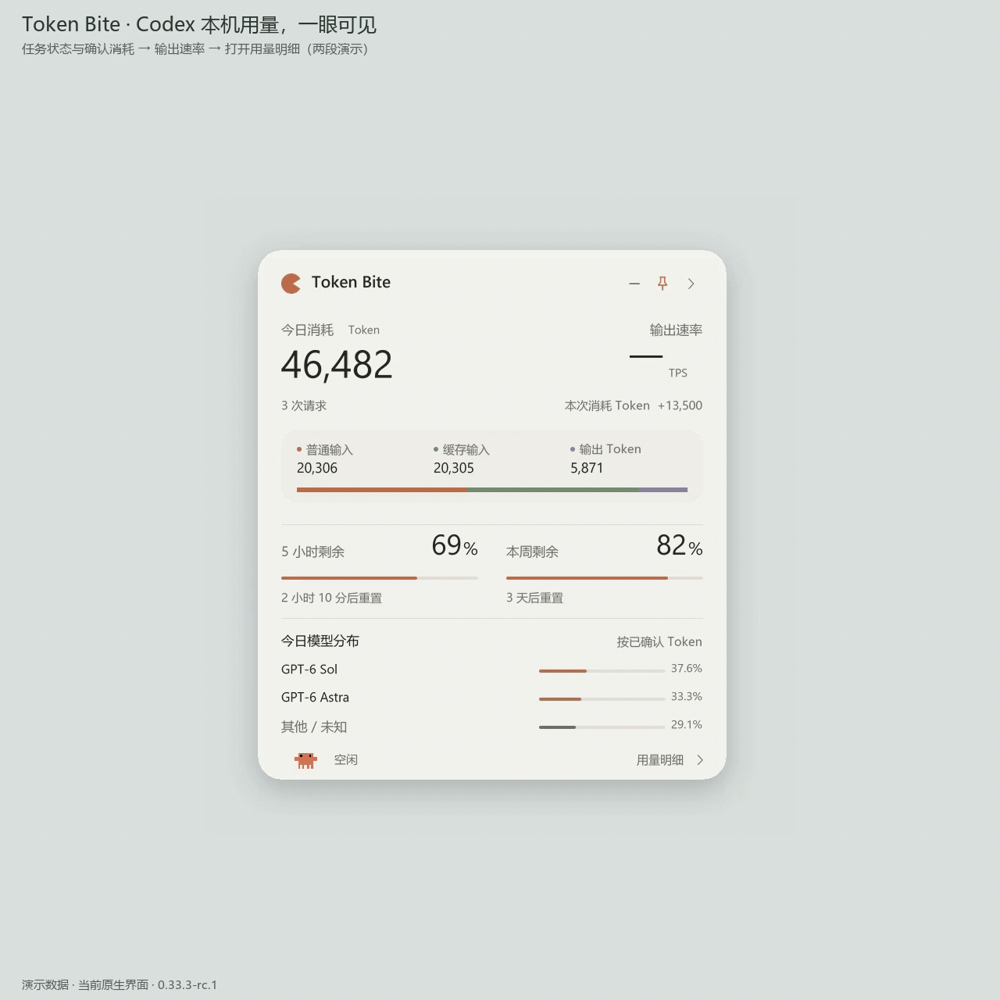
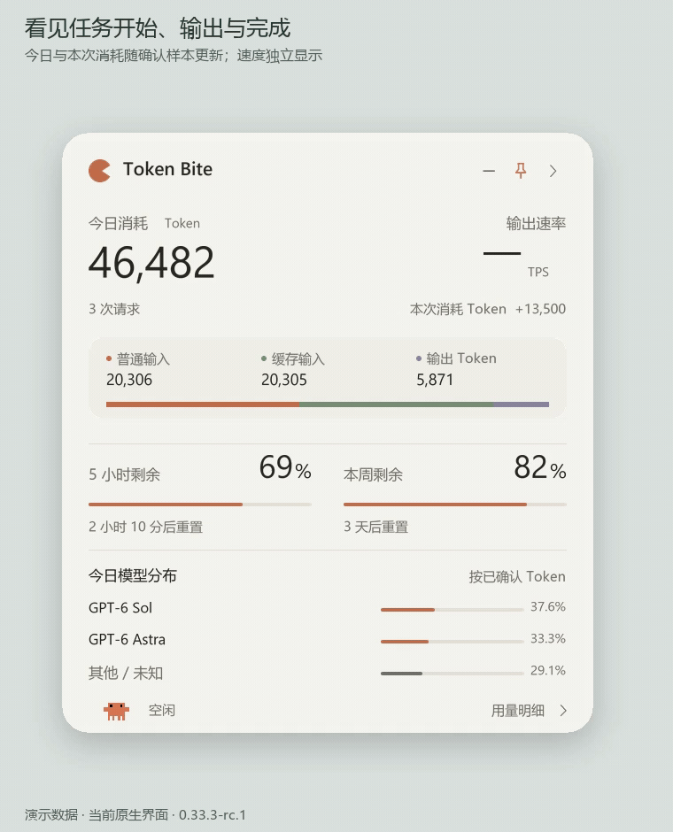
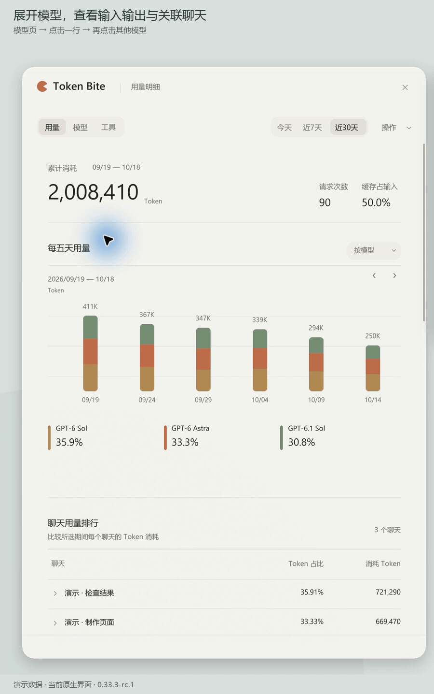
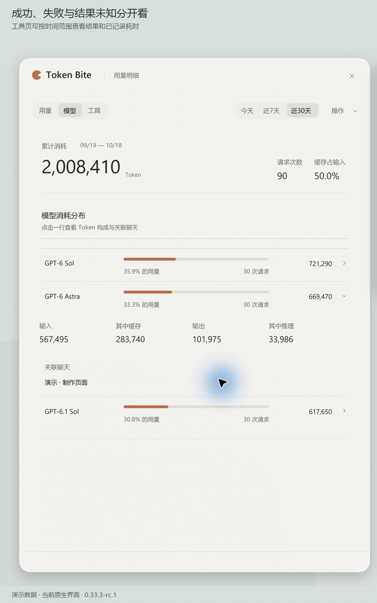
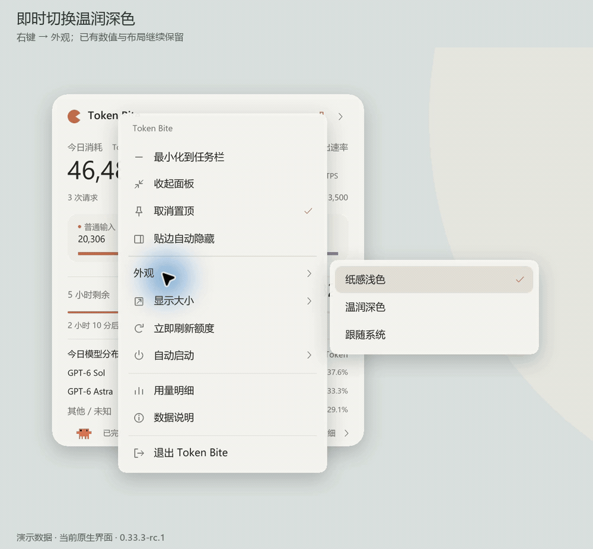

# Token Bite

**把本机 Codex 的用量、额度和任务状态，放进一个 Windows 浮窗。**

Windows 11 x64 · 免安装 · 0.33.3-rc.1 试用版 · 闭源分发

**当前仅开放产品介绍与动图预览，安装包尚未开放下载。**

[下载状态与安装说明](docs/DOWNLOAD.md) · [全部功能动图](docs/FEATURES.md) · [指标与常见问题](docs/FAQ.md) · [隐私说明](docs/PRIVACY.md)

动图以隔离演示数据为主；“趋势图放大与平移”按素材包标注采用已脱敏的真实统计快照，制作为离屏交互演示（非桌面录屏）。这些素材不作为性能测试或实体鼠标操作验收。

## 一眼看到这次用了多少

今日消耗、本次任务批次消耗，以及普通输入／缓存输入／输出构成集中展示。任务状态与输出速率分别显示，避免把思考或工具执行误当作正在输出文字。

额度按 Codex 实际返回的周／5 小时窗口展示；未知显示横线，过期值变暗。本机 Token 数量与官方额度百分比是两种指标。

## 知道消耗在哪里

用量明细提供今天、近 7 天、近 30 天视图，可按日期筛选，查看模型分布与聊天排行，展开输入、缓存和输出构成，并导出 CSV。

历史视图覆盖已发现并缓存的本地记录，不代表完整历史导入。

## 工具结果也能分清

工具页区分成功、失败、结果未知，以及可确认的耗时。用量页还能查看工具、技能和用户消息趋势。

## 趋势图可以放大看

打开独立大图后，可放大、拖动平移、隐藏图例、查看日期读数，再一键复原。

## 浅色、深色，按习惯摆放

提供纸感浅色、温润深色和跟随系统；支持精简／展开、显示大小、置顶、拖动、贴边自动隐藏及可选跟随启动。

[查看全部 24 个动图及操作入口 →](docs/FEATURES.md)

## 下载状态与使用方式

安装包目前保留在未发布的 Release 草稿中，暂不提供公开下载。以下步骤供正式开放后参考。

1. 正式开放后，在本仓库的 **Releases** 中选择 **v0.33.3-rc.1**，下载 `TokenBite-v0.33.3-rc.1-windows-x64.zip`。
2. 完整解压到可写文件夹，保留 `TokenMini.exe` 和同级 `_internal` 文件夹；双击 `TokenMini.exe`。无需另装 Python。
3. 使用本机 Codex。首次读取可能需要等待；准确消耗在本地日志确认后更新。
4. 点击浮窗的“用量明细”深入查看；右键可设置外观和窗口行为。

本版核实环境为 Windows 11 x64。用量统计需要本机可读的 Codex 日志；官方额度依赖本机已登录的 Codex CLI。普通 ChatGPT 聊天、其他设备和未落盘的云端活动不计入本机统计。

## 数据与反馈

程序在本地读取日志、会话索引和运行状态，解析过程中会接触可见输出文本。设置与统计保存在程序同级 `data` 文件夹；官方额度查询可能通过 Codex CLI 联网。详情见[隐私说明](docs/PRIVACY.md)。

遇到问题请到本仓库 **Issues → New issue**，提供版本、系统版本、重现步骤和脱敏截图。请勿公开 `data` 文件夹、认证信息或原始聊天日志。

## 分发与许可

本仓库用于产品展示、文档与下载，**不公开 Token Bite 源代码**。程序按[二进制使用条款](LICENSE.txt)分发；第三方组件保留各自许可，见[第三方声明](THIRD-PARTY-NOTICES.md)。

Token Bite 是独立项目，与 OpenAI、Anthropic 无隶属或背书关系。当前为未签名试用版；兼容性与已知边界见[发布说明](docs/RELEASES.md)。
