# 功能动图与操作入口

全部画面对应 0.33.3-rc.1。活动趋势与大图操作采用 2026/10/12—10/18 同一历史时点的脱敏真实统计，使用当前原生绘图代码离屏生成（非桌面录屏）；其他片段仍为隔离演示数据。离屏片段使用程序支持的纸感实色回退及示意光标，点击可看原尺寸，不替代实体操作、原生磨砂或异常恢复验收。

[日常使用](#日常使用) · [用量分析](#用量分析) · [活动趋势](#活动趋势) · [外观与窗口](#外观与窗口) · [没有动态录像的功能](#没有动态录像的功能)

## 总览

### 产品总览

从浮窗查看今日用量，再打开明细。总览由两段原生演示画面组成，转场会切换场景。

[静态封面](../media/posters/overview.png)

## 日常使用

### 任务开始、输出与完成

观察今日消耗、本次消耗和输出速率。演示数据由隔离样本驱动，不是实测跑分或真实并发任务录像。

[静态封面](../media/posters/task-progress.png)

### 额度窗口与时效

按实际返回的数据展示周额度、5 小时额度或双窗口；未知和过期样本有不同表现。这是界面状态样本。

<a href="../media/gifs/quota-windows.gif">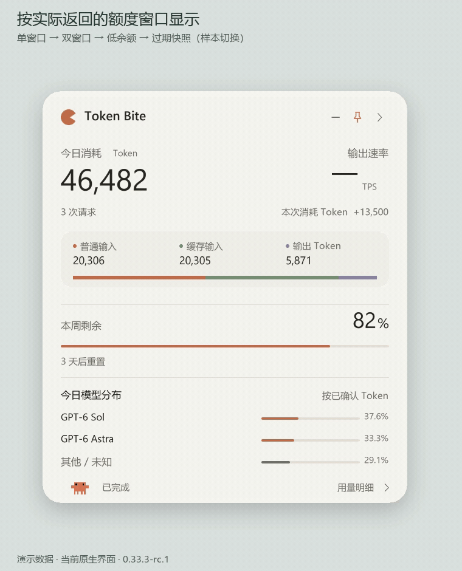</a>

[静态封面](../media/posters/quota-windows.png)

### 任务阶段

区分思考、工具执行、等待批准和文字输出。画面展示隔离状态样本，批准动作仍需回到 Codex 完成。

<a href="../media/gifs/task-phases.gif">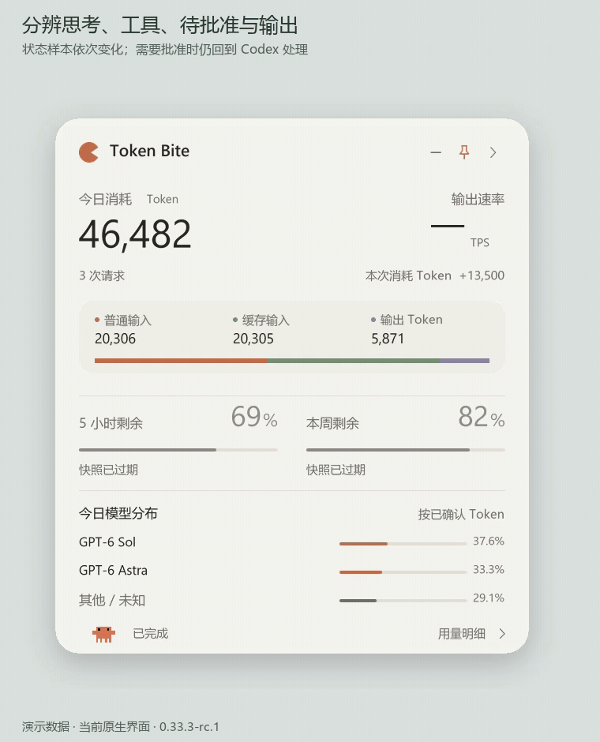</a>

[静态封面](../media/posters/task-phases.png)

### 未同步提示与恢复状态

数据不可用时保留最后确认值并提示，恢复后重新显示。这是隔离状态展示，不是真实网络断线恢复测试。

<a href="../media/gifs/stale-state.gif">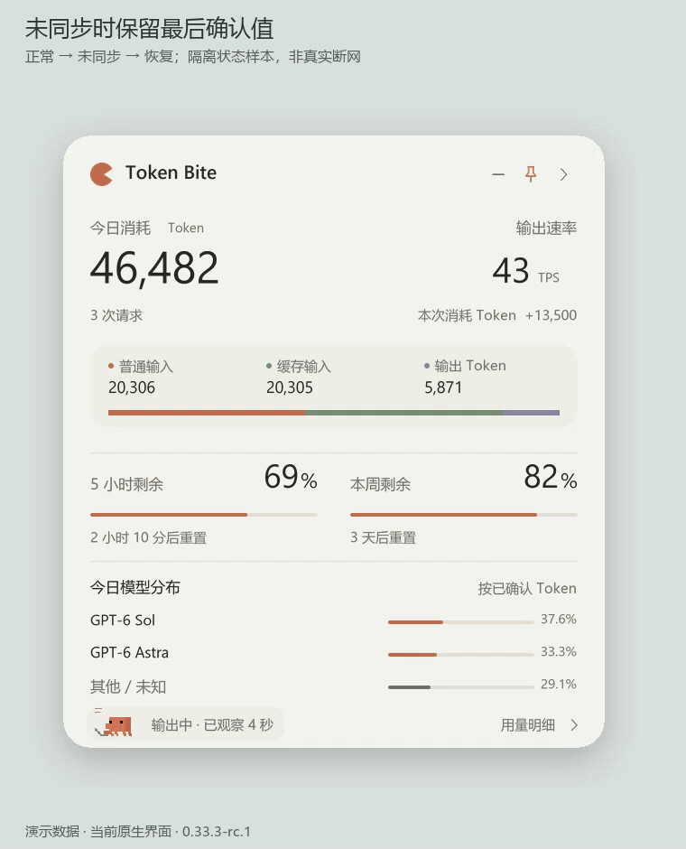</a>

[静态封面](../media/posters/stale-state.png)

### 程序内数据说明

从右键菜单打开数据说明，查看指标定义和隐私相关说明。

<a href="../media/gifs/data-help.gif">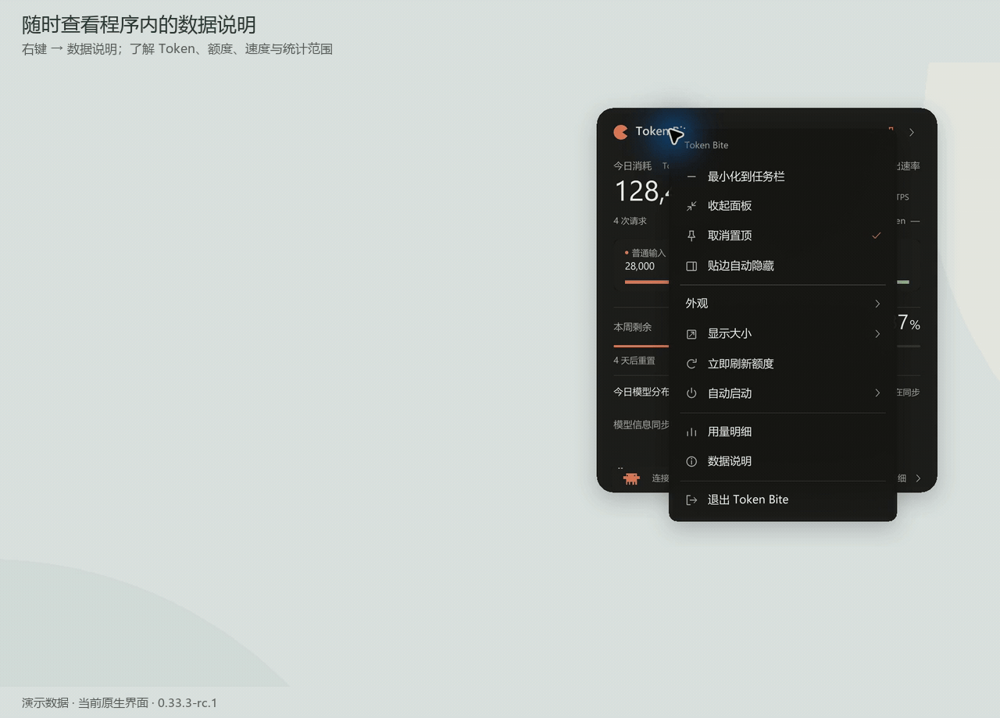</a>

[静态封面](../media/posters/data-help.png)

## 用量分析

### 打开用量明细

点击浮窗右下角的用量明细，打开独立分析窗口。

<a href="../media/gifs/open-details.gif">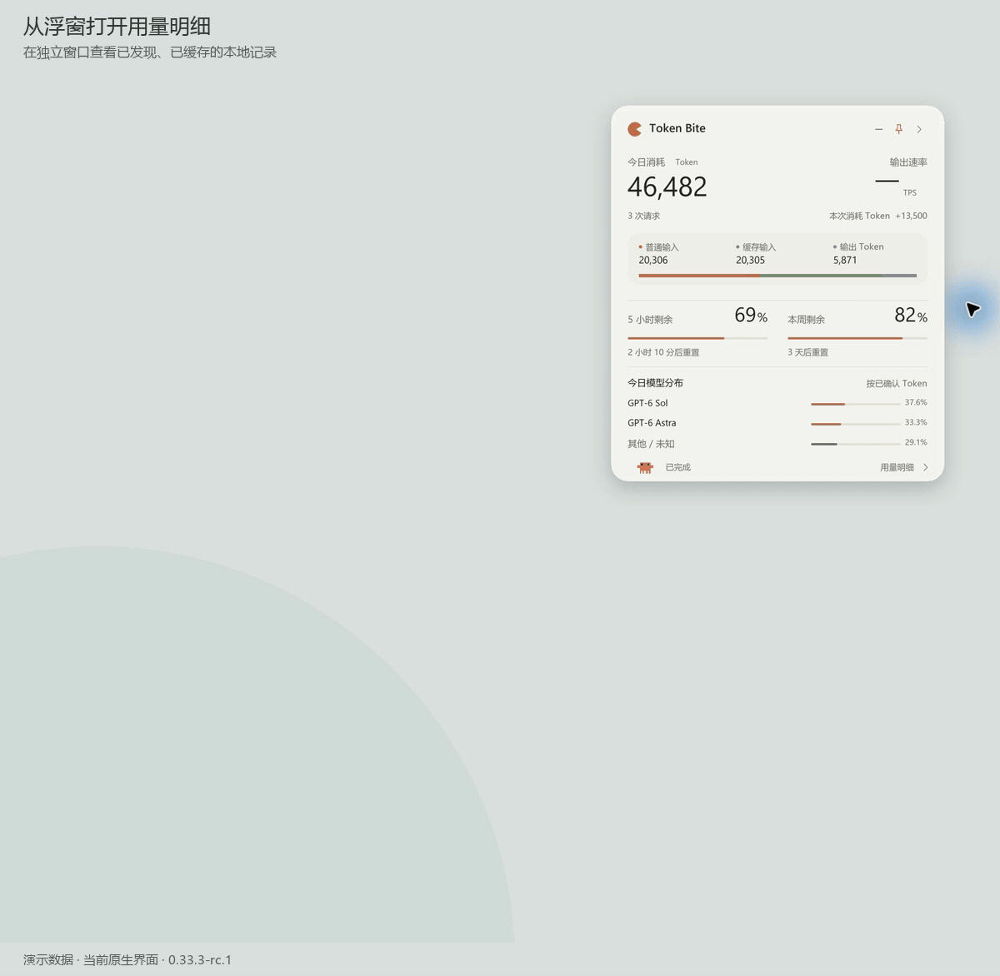</a>

[静态封面](../media/posters/open-details.png)

### 切换统计范围

在今天、近 7 天和近 30 天之间切换；范围内只包含已发现并缓存的本地记录。

<a href="../media/gifs/date-ranges.gif">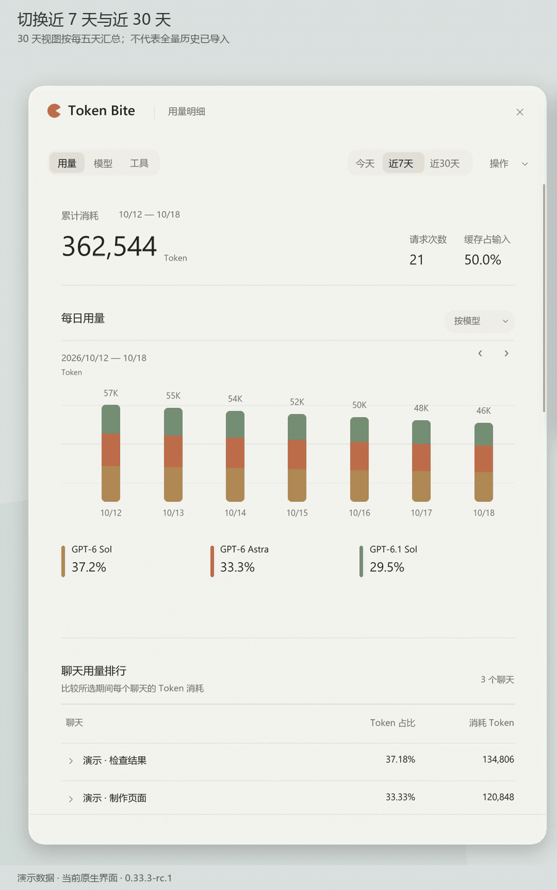</a>

[静态封面](../media/posters/date-ranges.png)

### 按日期筛选

点击柱状图中的日期区间，再清除筛选，查看统计如何联动。

<a href="../media/gifs/date-filter.gif">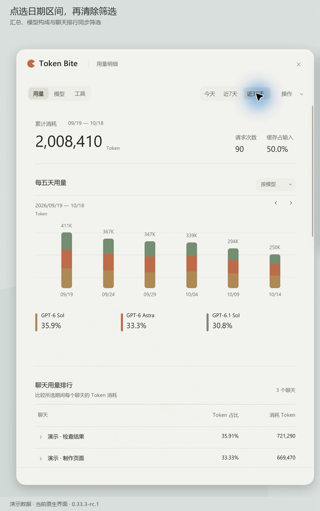</a>

[静态封面](../media/posters/date-filter.png)

### 模型分布与构成

展开模型行，查看输入、缓存、输出及关联聊天，再切换另一行。

[静态封面](../media/posters/model-breakdown.png)

### 工具执行结果

分开查看成功、失败、结果未知和可确认耗时；缺少结果不等于成功。待批准和运行中两栏在本片样本中为零。

[静态封面](../media/posters/tool-results.png)

### 核对统计

在明细菜单中核对当前工具统计。该片不代表外部官方账单核对。

<a href="../media/gifs/reconcile.gif">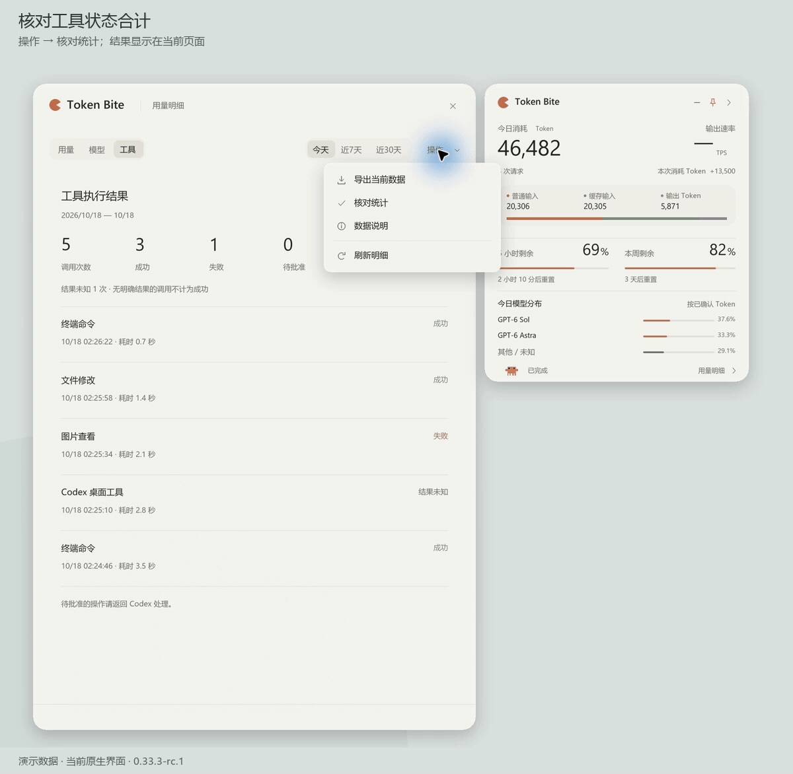</a>

[静态封面](../media/posters/reconcile.png)

### 聊天排行与详情

展开聊天，查看 Token 构成、模型、推理强度和速度模式等已记录维度。打开聊天的入口仅展示，没有跳转正式 Codex。

<a href="../media/gifs/chat-breakdown.gif">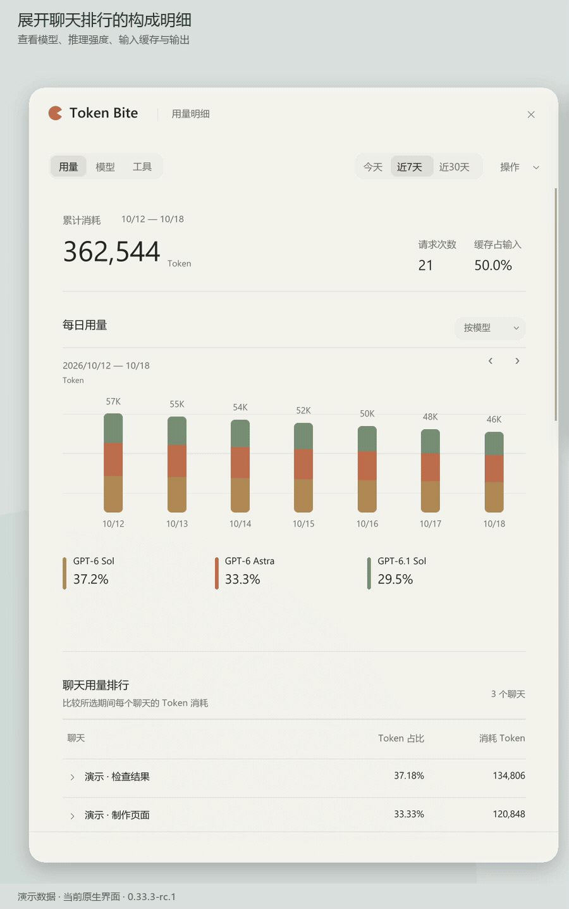</a>

[静态封面](../media/posters/chat-breakdown.png)

## 活动趋势

### 滚动查看活动趋势

从聊天排行向下滚动查看工具调用趋势。此冻结快照合计 6,152 次，四类曲线分别来自实际统计。

[静态封面](../media/posters/scroll-trends.png?v=4ae3c564676e) · [MP4 原片](../media/videos/scroll-trends.mp4?v=949f3902e9dc)

### 趋势图放大与平移

使用“＋”从 100% 放大至 150%，拖动查看局部日期，再点击复原。该片按素材包标注使用脱敏后的真实统计快照，采用离屏交互演示（非桌面录屏），保留原有曲线与计数。产品也支持 Ctrl＋滚轮，本片未单独展示该组合输入。

[静态封面](../media/posters/chart-zoom-pan.png?v=815e4356b348)

### 图例筛选与日期读数

点击终端命令图例隐藏／恢复曲线，再指向日期查看数值。10 月 15 日四类读数为 1,230／247／162／152；筛选只改变显示，合计和纵轴不变。

[静态封面](../media/posters/chart-legend.png?v=1404df2434ee) · [MP4 原片](../media/videos/chart-legend.mp4?v=f2a94abb00c8)

### 复原趋势图

点击复原，将 150% 的局部大图返回 100% 完整日期范围。复原只改变横向视口，保持原始数值和所选日期。

[静态封面](../media/posters/chart-reset.png?v=977bf0e532aa) · [MP4 原片](../media/videos/chart-reset.mp4?v=76248cce6cd2)

### 技能与用户消息趋势

向下滚动，分别查看技能使用 131 次与用户消息 404 条。两类活动使用各自的真实曲线；部分日志未读取提示如实保留，统计不代表全部历史。

[静态封面](../media/posters/skills-messages.png?v=e47898e06b81) · [MP4 原片](../media/videos/skills-messages.mp4?v=1ee688568dfc)

### 切换消息统计维度

将 404 条用户消息从按模型切换为按使用端。此快照包含 Codex 桌面端 399 条、编辑器 5 条；没有虚构 CLI 或普通 ChatGPT 记录。

[静态封面](../media/posters/message-dimensions.png?v=5daf45747eb1) · [MP4 原片](../media/videos/message-dimensions.mp4?v=fef1060b3480)

### 打开趋势大图

从工具调用趋势右上角的放大入口打开独立大图。父图与大图共用打开时的快照，合计均为 6,152 次。

[静态封面](../media/posters/open-chart.png?v=26714b3814a2) · [MP4 原片](../media/videos/open-chart.mp4?v=c476e764fd74)

## 外观与窗口

### 浅色与深色

右键 → 外观，切换纸感浅色和温润深色。菜单还提供跟随系统；本片没有改变 Windows 主题来演示自动跟随。

[静态封面](../media/posters/themes.png)

### 跟随启动选项

查看跟随 Codex、跟随 Codex 和 ChatGPT 桌面版、关闭自动启动三项。仅展示菜单，没有改变真实启动项；跟随 ChatGPT 启动不表示统计普通 ChatGPT。

<a href="../media/gifs/startup-options.gif">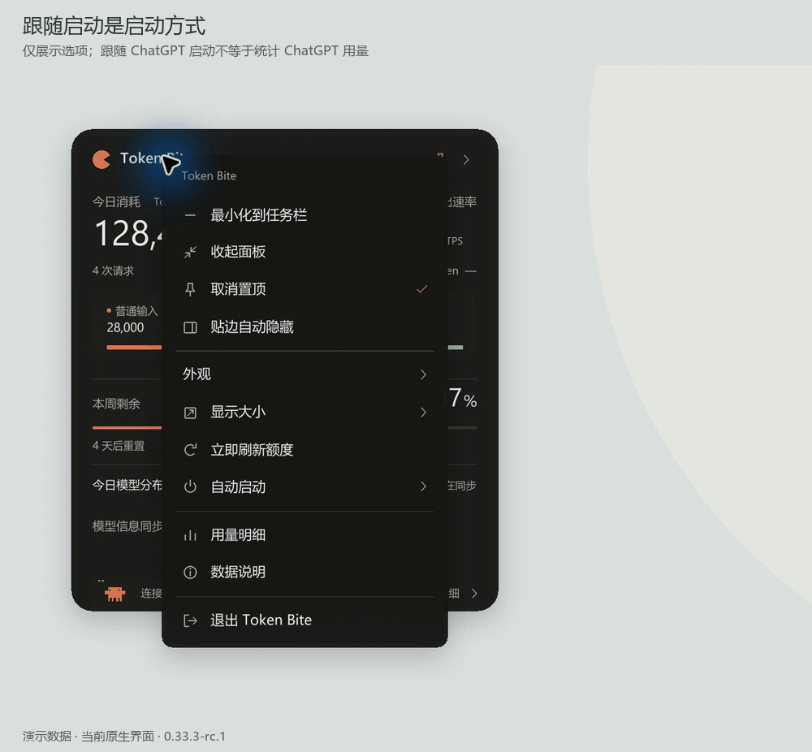</a>

[静态封面](../media/posters/startup-options.png)

### 退出重开保留设置

隔离副本退出后重新启动，保留外观和窗口位置。

<a href="../media/gifs/restore-settings.gif">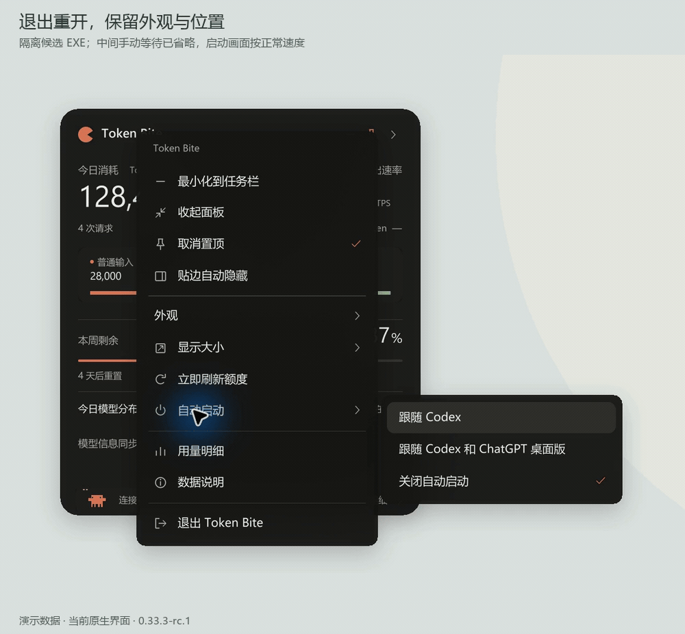</a>

[静态封面](../media/posters/restore-settings.png)

### 置顶与拖动

切换置顶开关，并拖动隔离浮窗；没有操作用户正在使用的正式浮窗。

<a href="../media/gifs/pin-drag.gif">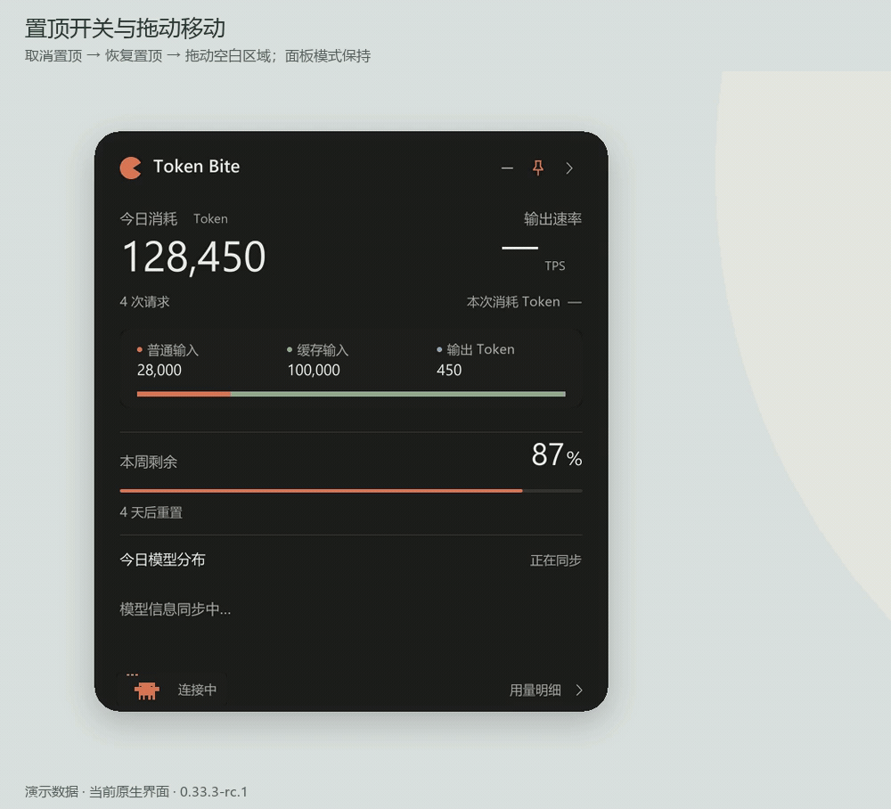</a>

[静态封面](../media/posters/pin-drag.png)

## 没有动态录像的功能

精简／展开、显示大小的切换录制中观察到短暂黑块，原因尚未确认；两个动态片段已撤下。以下仅是稳定状态的静态对照。

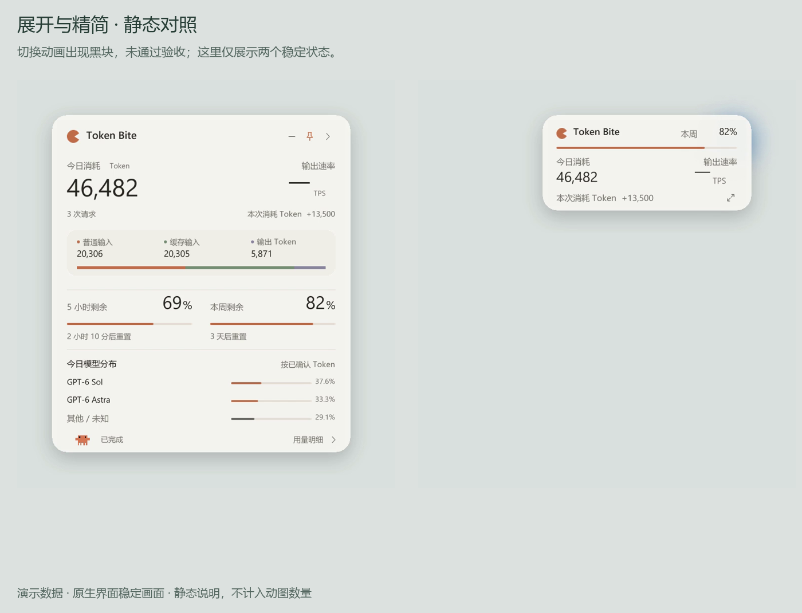

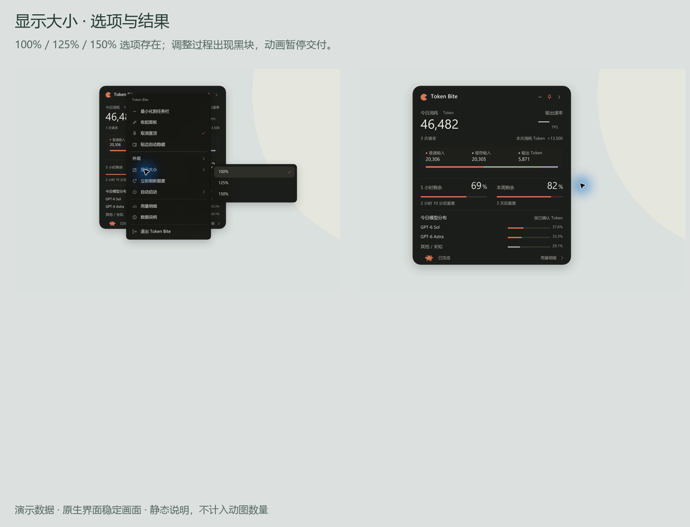

贴边自动隐藏的完整唤回、物理托盘右键／双击、Windows 登录自启动、系统主题自动变化、减少动画、真实并发任务与故障恢复，没有在本套素材中完成独立的端到端录像。CSV 具备导出功能，但本套没有单独录制保存文件对话框。它们的文字说明不算动态演示验收。

[返回首页](../README.md) · [下载与安装](DOWNLOAD.md)
